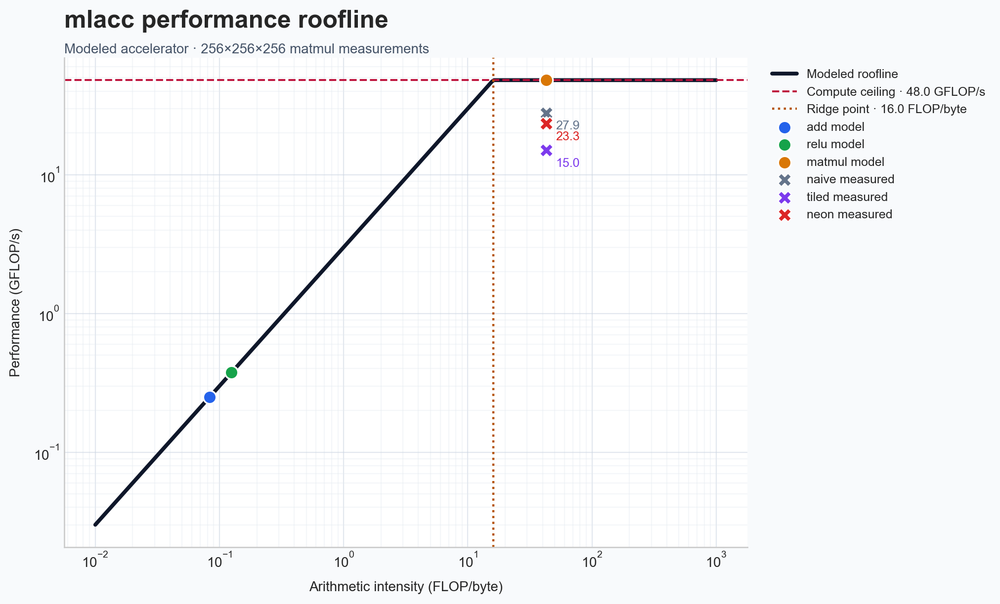
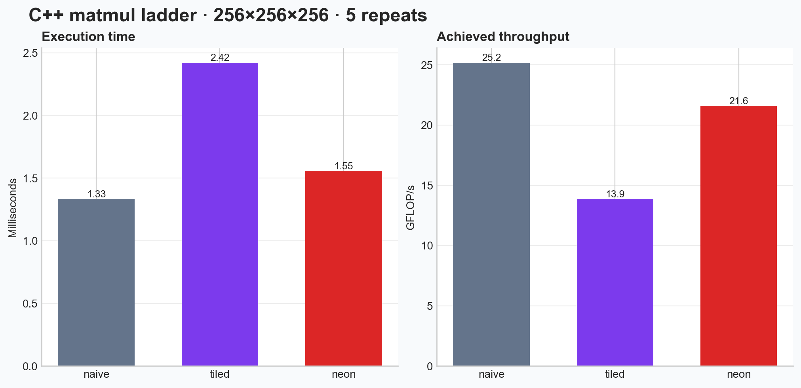

# mlacc

This project traces a model graph, applies compiler transformations, lowers
the result to a Load/Store/Compute instruction set, and evaluates execution
with functional simulation and a hardware cost model. Its structure follows
the compiler stages used by ML accelerator software, including graph
rewriting, code generation, buffer management, and performance analysis.

## Pipeline

```
PyTorch nn.Module
      |  torch.fx.symbolic_trace
      v
   mlacc IR (Graph of Ops)
      |  fusion pass
      v
   Fused IR (elementwise chains merged)
      |  codegen
      v
   Toy ISA (Load / Store / Compute)
      |  simulator
      v
   Cycle count + final memory state
```

Each stage is a standalone module, so any stage can be tested and reasoned
about independently of the ones around it.

## What the fusion pass does

`passes/fusion.py` walks the graph and merges consecutive elementwise ops
(`add`, `relu`, `mul`) into a single `fused_elementwise` instruction whenever
two conditions hold:

- every op in the chain is elementwise
- the tensor connecting two ops in the chain has exactly one consumer

The second condition is what makes this a correctness-preserving
transformation rather than just a memory optimization. If a tensor feeds two
different ops, folding it into one of them would silently drop the other
op's input. `matmul` is excluded from the elementwise set entirely, since it
has a different cost profile (compute-bound rather than memory-bound) and
fusing it would break the fusability analysis.

## Instruction set and cost model

The ISA has three instructions: `Load`, `Store`, and `Compute`. The
simulated hardware has one compute core, one on-chip buffer, and one
off-chip memory. This isolates the specific thing the project measures:
the off-chip memory traffic that fusion removes.

Cost model:
- `Load` / `Store`: `size_bytes / memory_bandwidth_bytes_per_cycle + fixed_memory_latency_cycles`
- `Compute`: `flops / compute_flops_per_cycle`

Fusion's effect on this model is direct: a fused chain of *N* elementwise ops
replaces *N* separate Store+Load round trips to off-chip memory with a
single Store and a single Load around the whole chain. Compute cost is
unchanged, since fusion doesn't change how much arithmetic happens, only how
often intermediate results cross the memory boundary.

```bash
python3 -m venv venv
source venv/bin/activate
pip install -r requirements.txt
```

## Codegen strategy

`lower_to_isa` uses the simplest possible strategy: every op's output is
stored to memory, and every op's input is loaded from memory. This keeps the
unfused case's Store+Load round trips visible and simple to reason about,
which is what makes the fused-vs-unfused comparison clean. A buffer-aware
codegen that kept values on-chip between dependent ops would collapse that
distinction and is left as a stretch goal.

## Results

_Fill in after running `main.py` on the example workload:_

| | Cycles | Off-chip Loads/Stores |
|---|---|---|
| Unfused | | |
| Fused | | |

## Relationship to prior work

The IR/fusion/ISA/codegen split mirrors the structure of TVM's Relay
(graph-level IR) and TE/TIR (schedule and low-level IR) split. The fusion
pass here implements one rule — merging linear chains of elementwise ops —
which is a special case of what TVM's `FuseOps` computes generally via
post-dominator tree analysis across multiple op categories.

This project's motivating idea — that fusion's benefit comes from cutting
memory traffic, not from doing less compute — is also the core idea behind
FlashAttention's kernel fusion and the fused kernels used in inference
engines like vLLM and SGLang.

## Repo layout

```
mlacc/
  ir.py              Op and Graph dataclasses
  passes/fusion.py   elementwise fusion pass
  isa.py             Load / Store / Compute instruction definitions
  cost_model.py       HardwareConfig and per-instruction cost functions
  simulator.py        executes instructions, tracks memory + cycles
  codegen.py          lowers a Graph to a list of instructions
  trace.py            traces a PyTorch nn.Module into a Graph
  main.py              end-to-end demo: fused vs. unfused comparison
examples/tiny_mlp.py
tests/
```

## Running

From the project root:

```
python tests/test_ir.py
python tests/test_fusion.py
python tests/test_simulator.py
python tests/test_codegen.py
python main.py
```

The simulator and code generator are NumPy-only, while the end-to-end CLI
uses the PyTorch FX front end:

- A memory tiling pass, applying the same traffic-reduction idea within a
  single op rather than across a chain of ops
- Matmul + bias + relu epilogue fusion, a pattern used in real inference
  kernels
- A second `HardwareConfig` with a different compute-to-bandwidth ratio, to
  show the regime where fusion's benefit shrinks or disappears

## Background reading

The command prints the unfused and fused cycle counts, verifies that both
schedules produce the same output, and sweeps sustained memory bandwidth and
buffer capacity. The current buffer model spills an output when the resident
tensors exceed capacity; tiled execution remains a separate stretch goal.

The cycle estimator also has a C++/pybind11 implementation. Build it with:

```bash
python setup.py build_ext --inplace
```

`mlacc.native.estimate_cycles` accepts the same ISA instructions and hardware
configuration as the Python simulator. The Python implementation remains the
functional reference; the native backend accelerates cycle estimation.

The native matmul ladder can be benchmarked with:

```bash
python -m mlacc.matmul_benchmark --m 256 --n 256 --k 256
```

It checks each implementation against NumPy before reporting timings for
naive, tiled, and NEON matmul.

Generate the roofline plot with:

```bash
python -m mlacc.roofline --output roofline.png \
  --benchmark-output matmul_benchmark.png
```

The command generates two presentation plots from the same benchmark:



The roofline shows modeled `add`, `relu`, and `matmul` points, the compute and
bandwidth ceilings, the ridge point, and measured native matmul points.



The benchmark chart shows execution time and achieved GFLOP/s for the C++
matmul ladder. Results are local measurements on Apple Silicon; NumPy uses
the platform's optimized Accelerate/BLAS implementation and is intentionally
not included in the C++-only comparison chart.

The unit tests build `Graph`/instruction objects directly. The FX front end
and end-to-end CLI require PyTorch.

## Implemented artifacts

- PyTorch FX tracing for `Linear` and `ReLU` models.
- Elementwise fusion with multi-consumer and non-elementwise safety checks.
- Load/Store/Compute code generation with buffer-aware spilling.
- Functional NumPy simulation and configurable cycle modeling.
- A C++ cycle estimator exposed through pybind11.
- Naive, tiled, and NEON matmul kernels with NumPy correctness checks.
- A roofline model and benchmark visualizations in `roofline.png` and
  `matmul_benchmark.png`.

## Current boundaries

- The simulator test suite has one pre-existing semantic mismatch: one test
  describes `relu(x - 10)` but emits `relu(x)`.
- Buffer-aware spilling is implemented; tiled execution is not.
- The modeled roofline uses explicit assumptions from `HardwareConfig`; it is
  not a measurement of the host CPU's peak performance.
